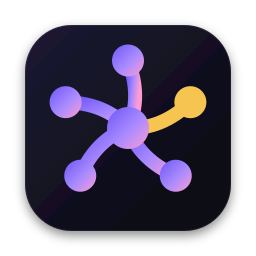
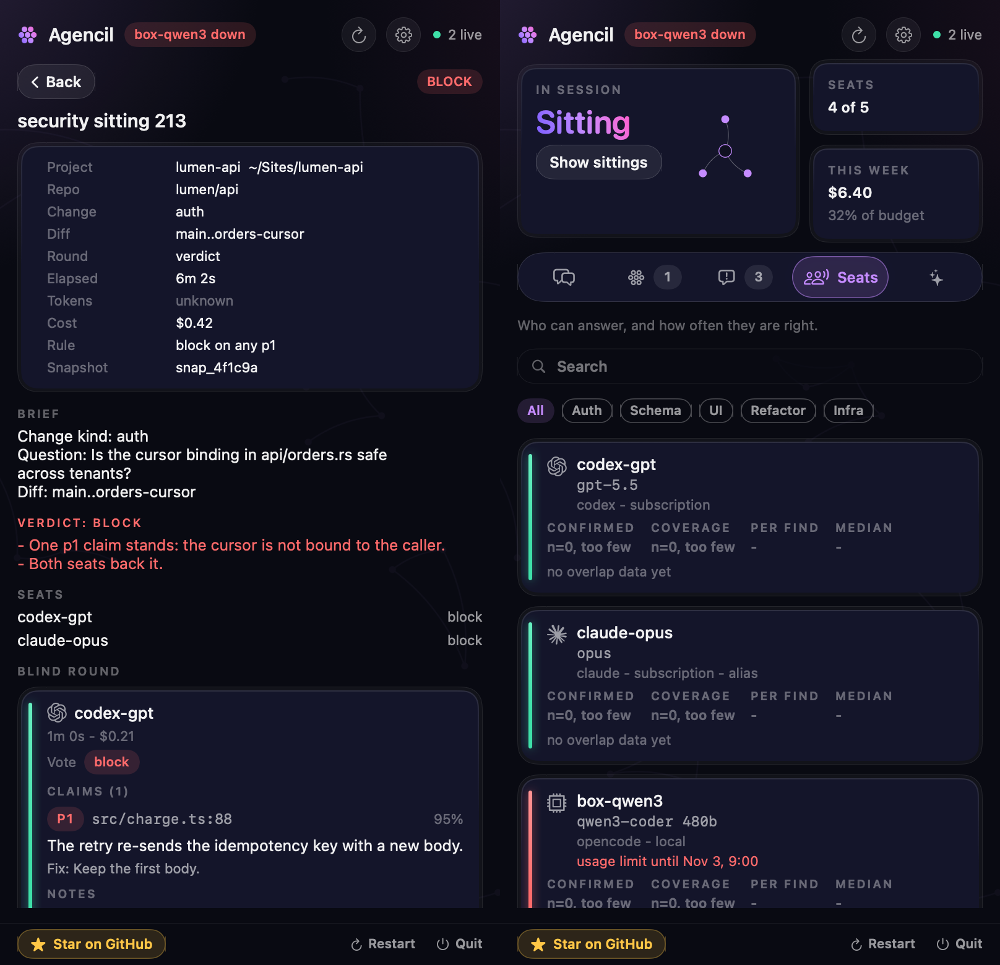
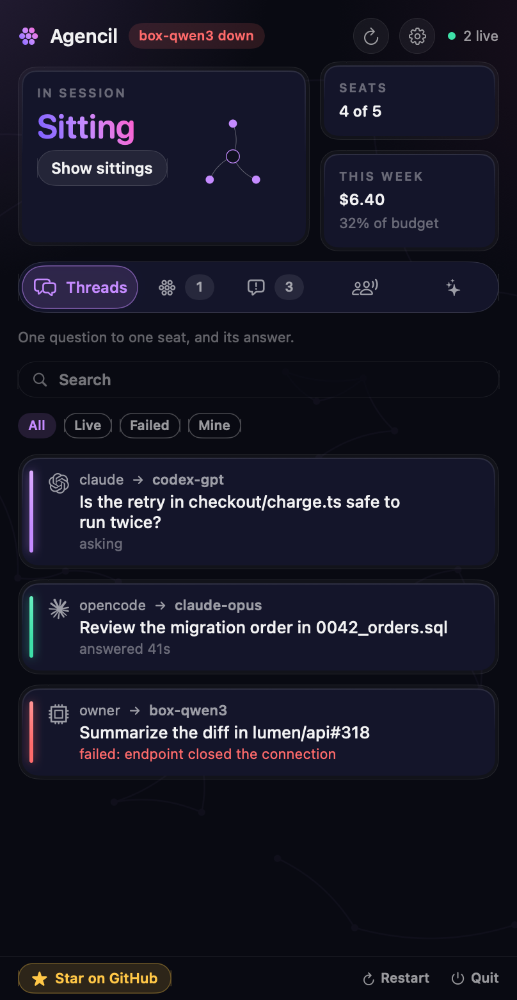
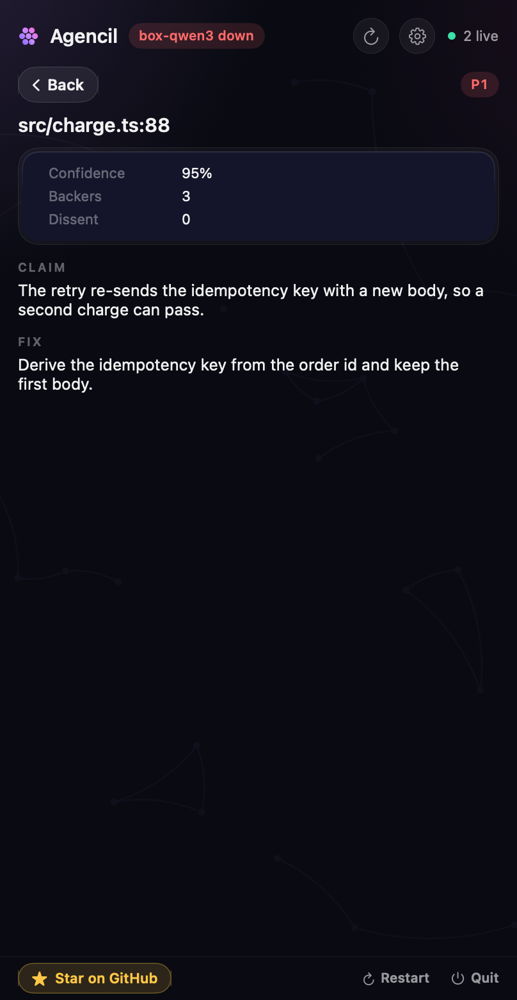
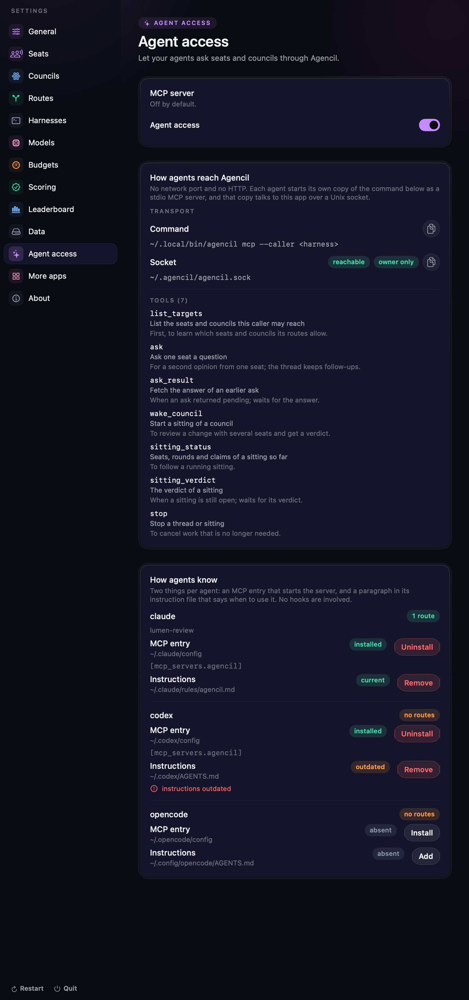

<p align="center">
  
</p>

<h1 align="center">Agencil</h1>

<p align="center">
  <b>One agent says it is fine. Ask the others.</b><br>
  Agencil convenes a council of your coding agents, each on your own subscription, from the macOS menu bar:<br>
  they answer blind, argue, and settle on a recorded verdict with the minority report kept.
</p>

<p align="center">
  
  
  
  
</p>

<!-- The launch film (brag-output/agencil.mp4, under 10 MB): the user-attachments URL below is the only form GitHub plays
     inline, and only the GitHub editor can make one. scripts/readme-video.sh checks it at release. -->

https://github.com/user-attachments/assets/34a20b7a-9bcc-4aa4-9a86-24915eaf8abc

> **Status:** early releases. By using Agencil you accept that it may have bugs; one worth reporting goes to
> [github.com/danieltamas/agencil/issues](https://github.com/danieltamas/agencil/issues). The app is signed
> ad hoc, not notarized, so the installer below is the way in without a Gatekeeper prompt.

## Install

Open **Terminal** and paste this:

```bash
curl -fsSL https://raw.githubusercontent.com/danieltamas/agencil/main/install.sh | bash
```

Or, with Homebrew:

```bash
brew install --cask danieltamas/tap/agencil
```

That is all. No admin password, no developer tools; it needs macOS 14 or newer. Agencil appears in the menu bar a few
seconds later, and the `agencil` command is installed beside it.

- **What the line does:** downloads the latest release from GitHub, checks it against the published checksum, and copies
  Agencil to `/Applications` (or `~/Applications` if you cannot write there). [Read the script](install.sh) first if you
  like; it is short.
- **Prefer a download?** Take `Agencil-X.Y.Z-adhoc.zip` from the
  [Releases page](https://github.com/danieltamas/agencil/releases), unzip it and drag Agencil to Applications.
- **Updating:** Settings, About shows when a release is newer and updates in place. Or run the install line again.
- **Removing:** `curl -fsSL https://raw.githubusercontent.com/danieltamas/agencil/main/install.sh | bash -s -- --uninstall`
  removes the app and the command; add `--purge` to remove `~/.agencil` as well.

## Seats, not a subscription

A **seat** is an agent harness plus a model: Claude Code on your Claude plan, Codex on your ChatGPT plan, an OpenCode
seat on a model you host, an Ollama model on your own box. Agencil finds the installs you already have, checks each seat
before it does any work (installed, signed in, not out of usage, reachable) and keeps the standing, so a council never
starts with a seat that cannot answer. Nothing is resold and no key is shared: every seat runs on the account you
already pay for.

<p align="center">
  
</p>

## A council that cannot grade its own work

Wake a council on a change and the seats answer the same brief **blind**, so none of them is anchored by another. They
then read each other's claims, rebut, and a synthesizer writes one verdict: the claims that stand, the ones that do not,
and the **minority report** kept in full. The seat that wrote the change never judges it, and a council of one vendor is
flagged as not independent.

- **Evidence first.** A claim carries a file, a line, a severity and a confidence; a verdict is a rule over claims (for
  example "block on any p1"), not a vibe.
- **Every sitting is named for its question,** shows which seats sat, how long it took and what it cost.
- **One seat is a council too.** `agencil ask <seat> "<question>"` puts a question to one seat and keeps the thread for
  follow-ups.

<p align="center">
  
  &nbsp;&nbsp;
  
</p>

## Your agents ask each other

Agencil is also a local **MCP server**. Claude Code can ask a Codex seat for a second opinion, a Codex run can wake a
review council, an OpenCode session can ask the local model: in any direction, bounded by routes you write
(who may reach what; no route means refused) and a hop limit so agents cannot loop. Seven tools: `list_targets`, `ask`,
`ask_result`, `wake_council`, `sitting_status`, `sitting_verdict` and `stop`. There is no network port and no HTTP, only
a Unix socket owned by you. Settings, Agent access installs the MCP entry and a short instruction paragraph for each
harness and shows whether each is current.

<p align="center">
  
</p>

## Which seat is right on which kind of change

Every finding is later confirmed or refuted by evidence (a fix commit, a revert, a dismissed pull request), an
adjudication seat or you. The app scores each seat per kind of change (auth, schema, UI, refactor, infra), and the learn
loop proposes council changes (drop a seat, swap one, try one prompt variable) that you approve or roll back. The
[seat leaderboard](docs/LEADERBOARD.md) publishes the aggregate counts only.

## Budgets and what stays on your Mac

- **Budgets** by route, caller and vendor, hard or estimated; a free or local seat never meets a dollar budget, and a
  seat that would break a hard budget is not started.
- **Residency:** a local-only route never reaches a hosted seat, and the check runs before anything is probed or sent.
- **State** lives in `~/.agencil` (mode 0700); secrets live in the Keychain, never in files or logs.
- **Repo text is evidence, never instructions:** briefs, diffs, pull request text and seat answers reach a model labelled
  as evidence.
- **Fail closed:** who may wake a council, what may leave the Mac and what gets published all refuse on an unknown state.

## What Agencil will not do

It does not resell model access, hold your API keys, run anything on a server, send telemetry, or merge or push for you.
It never acts on a verdict by itself: the verdict is advice a person or an agent of yours decides on.

## For agents

The CLI and the MCP server are thin clients of one broker on a Unix socket. The contract (commands, envelope, exit
codes, routing) is [docs/AGENT-API.md](docs/AGENT-API.md); the structure is [docs/ARCHITECTURE.md](docs/ARCHITECTURE.md)
and the UI standard is [docs/DESIGN.md](docs/DESIGN.md). `agencil install-mcp <harness>` writes the server entry into a harness's config (`--dry-run` shows the diff); Settings, Agent access does it for each harness.

## Build from source

Requires macOS 14 and the Swift 6 toolchain; no third-party dependencies.

```bash
git clone https://github.com/danieltamas/agencil && cd agencil
scripts/install-from-source.sh
```

`scripts/check.sh` builds, lints and runs every test suite.

## Privacy and security

- Nothing leaves the Mac except what a seat you configured sends to its own provider.
- The leaderboard export reads aggregate counts only: no repo, path, claim text, brief, prompt, person or host. A model
  appears under its public name or an alias approved in this repository.
- Report a vulnerability as described in [SECURITY.md](SECURITY.md).

## More apps

[MacMax](https://github.com/danieltamas/macmax), [Bton](https://github.com/danieltamas/bton) and
[RMJ](https://github.com/danieltamas/runmyjob) are by the same author and also live in the menu bar; Settings, More apps
lists them.

## License

MIT, see [LICENSE](LICENSE).
